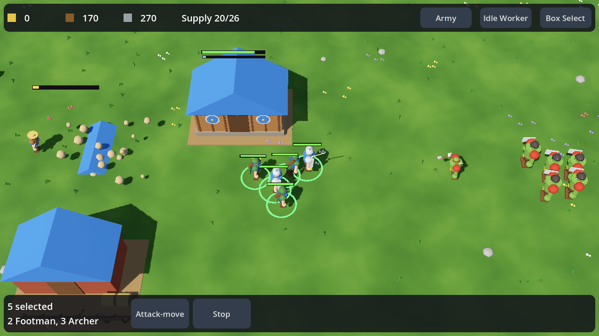

# Mythic RTS

A touch-first **3D** real-time strategy game for **iPhone and iPad**, built with **Godot 4**,
in a stylised / heroic, Warcraft-like look.
Mythical factions — humans, orcs, and soon elves, vampires, fairies and more — gather
resources, raise bases and fight for control of the land.



> **Status: playable prototype (v0.2).** Humans vs. Orcs skirmish against an AI opponent,
> rendered in 3D with code-built placeholder models. They are swapped for real models simply by
> dropping `.glb` files into `art/`; see [docs/ART_GUIDE.md](docs/ART_GUIDE.md).

## What's in the game so far

- **Two factions**, defined entirely in data (`data/factions/*.json`). Each faction has:
  - 5 units: a builder, melee, ranged, heavy and siege (vehicle) unit
  - 6 buildings: an HQ, a supply farm, two production buildings, a drop-off mill and a siege workshop
- **Economy.** Builders gather gold, wood and stone and carry it back to the HQ or a mill. Farms raise your supply cap.
- **Construction.** Placing a building creates a construction site, and builders finish it over time.
- **Tech requirements.** For example, archers need a Lumber Mill and Stables need a Barracks.
- **Combat.** Melee and ranged units, splash-damage siege engines, auto-targeting and attack-move.
- **AI opponent.** It manages its economy, follows a build order from the faction file, trains an army and attacks in growing waves after a peaceful opening.
- **Touch controls and HUD**, built for phones and tablets and safe-area aware.
- **3D view**:
  - a fixed-angle RTS camera with real-time sun and shadows
  - units that turn and animate as they walk, fight, mine and build
  - buildings that rise out of the ground as they're built and smoke when damaged
  - a border forest around the map
- **Art pipeline**:
  - every model can be replaced by a file, which is auto-detected
  - team colours are applied to any material named "team"
  - imported animations play automatically

## Controls

| Gesture | What it does |
|---|---|
| Tap a unit or building | Select it |
| Double-tap a unit | Select all of that type on screen |
| Tap ground / enemy / resource | Move / attack / gather with the selection |
| Tap a building with nothing selected | Select it (trains units; tap the ground to set its rally point) |
| One-finger drag | Pan the camera |
| Pinch | Zoom |
| **Box Select** button, then drag | Draw a selection box |
| **Army** / **Idle Worker** buttons | Quick-select your army / cycle idle workers |
| **Attack-move**, then tap the ground | Advance and fight anything on the way |

Taps hit what you see on screen. Tapping a soldier's head or a tower's roof selects it.
When building, tap a building button and a see-through ghost of the building appears. Tap or drag the ghost
to position it, then tap it again (or press **Place**) to start construction.

On desktop, the left mouse acts as touch, the wheel zooms and right-click issues commands.

## Getting started

### Requirements

- **Godot 4.3** or later (standard build): https://godotengine.org/download
- For iOS builds you also need:
  - a **Mac with Xcode**
  - the Godot **export templates**, installed from Godot under *Editor → Manage Export Templates*
  - an **Apple Developer** account. A free account works for running on your own device; a paid membership is needed for TestFlight and the App Store.

### Run it

1. Clone the repo, open Godot and **Import** `project.godot`.
2. Press **F5** to play. The game opens in a 1280×720 window. Mouse clicks emulate touch.

### Run it on an iPhone or iPad

1. In Godot, go to *Project → Export…* and select the **iOS** preset that ships with the project.
2. Fill in your **App Store Team ID**. The bundle identifier is set to `com.luckynoodle.mythicrts`; change it if you like.
3. Click **Export Project** and choose a folder. Godot generates an Xcode project there.
4. Open the `.xcodeproj` in Xcode, select your device, and press **Run**.

The preset targets iPhone and iPad, iOS 14+, landscape.

## Project layout

```
data/factions/        Faction definitions (units, buildings, costs, AI build orders)
scenes/main.tscn      The skirmish scene (everything else is built in code)
scripts/autoload/     GameData (loads JSON) and Game (match state, spawning, queries)
scripts/entities/     Entity base class, Unit, Building, ResourceNode, Projectile
scripts/view3d/       3D view: WorldView, RTSCamera, model library, placeholders, visuals
scripts/input/        TouchInput (gestures → commands), placement ghost, markers
art/                  Drop-in 3D models (see docs/ART_GUIDE.md)
scripts/ui/           HUD (resource bar, selection panel, action buttons)
scripts/ai/           SimpleAI opponent
tests/                Automated touch-input tests
tools/                Data validator and test runner
docs/                 Roadmap and how to add a faction
```

### How it fits together

- **Data-driven factions.** `GameData` loads every JSON file in `data/factions/`.
  Units, buildings, costs, requirements and AI build orders all live in those files,
  so adding the elves is mostly writing `elves.json`. See [docs/ADDING_A_FACTION.md](docs/ADDING_A_FACTION.md).
- **`Game` autoload.** Owns the players, spawns entities and answers shared queries
  such as *nearest drop-off*, *nearest enemy*, *is this area free*, and *supply used*.
- **`Unit`.** A small state machine with the states `IDLE`, `MOVE`, `ATTACK`, `GATHER`, `RETURN` and `BUILD`.
  The player's `TouchInput` and the `SimpleAI` both drive units through the same `command_*` methods.
- **`Building`.** Handles construction progress, training queues, rally points, drop-off and supply.
- **The simulation is 2D; the view is 3D.** The game logic runs on a flat plane in pixels,
  in a hidden `World` node. `WorldView` mirrors it every frame in 3D at 16 px = 1 m, and
  `RTSCamera` converts between screen and world. Art can therefore change freely without
  touching gameplay, and the simulation stays deterministic for future multiplayer.

## Testing

```bash
python3 tools/validate_data.py                               # check faction JSON
GODOT=/path/to/godot tools/run_tests.sh                      # everything below
godot --headless -- --run-input-tests                        # simulated touch tests
godot --headless -- --run-model-tests                        # 3D model pipeline + placeholders
godot -- --ai-vs-ai --screenshots=/tmp/shots                 # review screenshots (needs a GPU)
godot --headless --fixed-fps 30 -- --ai-vs-ai --quit-after-seconds=600   # AI vs AI match
```

GitHub Actions runs `tools/run_tests.sh` on every push and pull request.

## Roadmap

See [docs/ROADMAP.md](docs/ROADMAP.md). The next big items are:
- real pathfinding
- fog of war and a minimap
- real models and animations, replacing the placeholders, plus sound
- more factions (elves, vampires, fairies)
- a main menu with faction select
